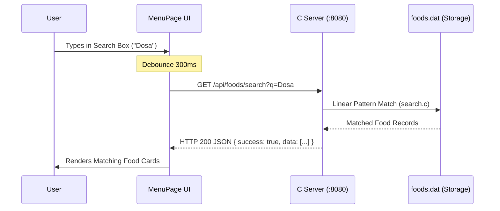

# 📊 Canteen Management System — Complete UI/UX, Button & Functional Audit
> **Authoritative Technical Blueprint & Functional Reference Manual**  
> *Project:* Canteen Management System (C + DSA High-Performance Backend & React 18 TypeScript Frontend)  
> *Date:* November 2026 | *Version:* 2.0-Production

---

## 📑 Table of Contents
1. [Architecture & Global Route Hierarchy](#1-architecture--global-route-hierarchy)
2. [Master Button & Interaction Directory](#2-master-button--interaction-directory)
3. [Authentication Screens (`/login`, `/register`)](#3-authentication-screens)
4. [Student Portal Screens](#4-student-portal-screens)
   - 4.1. [Student Shell & Navigation (`StudentLayout`)](#41-student-shell--navigation)
   - 4.2. [Student Home Dashboard (`/student`)](#42-student-home-dashboard)
   - 4.3. [Interactive Food Menu (`/student/menu`)](#43-interactive-food-menu)
   - 4.4. [Shopping Cart & Checkout (`/student/cart`)](#44-shopping-cart--checkout)
   - 4.5. [Order History (`/student/orders`)](#45-order-history)
   - 4.6. [Live Order Tracking (`/student/orders/:id`)](#46-live-order-tracking)
   - 4.7. [Printable Receipt Voucher (`/student/orders/:id/receipt`)](#47-printable-receipt-voucher)
   - 4.8. [Student Profile (`/student/profile`)](#48-student-profile)
5. [Admin Portal Screens](#5-admin-portal-screens)
   - 5.1. [Admin Shell & Drawer (`AdminLayout`)](#51-admin-shell--drawer)
   - 5.2. [Admin Dashboard (`/admin`)](#52-admin-dashboard)
   - 5.3. [Food Catalog & CRUD (`/admin/foods`)](#53-food-catalog--crud)
   - 5.4. [Live Kitchen Order Queue (`/admin/orders/queue`)](#54-live-kitchen-order-queue)
   - 5.5. [Master Orders Management (`/admin/orders`)](#55-master-orders-management)
   - 5.6. [Inventory & Stock Audit (`/admin/inventory`)](#56-inventory--stock-audit)
   - 5.7. [Analytics & Popular Items (`/admin/analytics`)](#57-analytics--popular-items)
   - 5.8. [Daily Sales Financial Audit (`/admin/sales`)](#58-daily-sales-financial-audit)
   - 5.9. [Admin Profile (`/admin/profile`)](#59-admin-profile)
6. [Data Structures & Algorithms (DSA) Backend Integration](#6-data-structures--algorithms-dsa-backend-integration)
7. [Mobile vs Desktop Responsive Architecture (Zero-Overlap Guarantee)](#7-mobile-vs-desktop-responsive-architecture)

---

## 🗺️ 1. Architecture & Global Route Hierarchy

```mermaid
flowchart TD
    Root["/ (Root URL)"] -->|Auth Guard Check| Guard{"Session Active?"}
    Guard -->|No Token| Login["/login (Unified Auth Page)"]
    Guard -->|Role: Student (0)| S_Home["/student (Student Home)"]
    Guard -->|Role: Admin (1)| A_Dash["/admin (Admin Dashboard)"]

    subgraph AuthFlow ["🔐 Authentication Flow"]
        Login -->|Register Switch| Register["/register (New Student Signup)"]
        Register -->|Success Redirect| Login
    end

    subgraph StudentPortal ["🎓 Student Portal"]
        S_Home --> S_Menu["/student/menu (Menu & Search)"]
        S_Home --> S_Cart["/student/cart (Shopping Cart)"]
        S_Home --> S_Orders["/student/orders (Order History)"]
        S_Orders --> S_Track["/student/orders/:id (Live 4-Step Tracker)"]
        S_Track --> S_Receipt["/student/orders/:id/receipt (Print Voucher)"]
        S_Home --> S_Profile["/student/profile (User Account)"]
    end

    subgraph AdminPortal ["👨‍🍳 Admin Portal"]
        A_Dash --> A_Queue["/admin/orders/queue (FIFO Order Queue)"]
        A_Dash --> A_Orders["/admin/orders (Master Orders Table)"]
        A_Dash --> A_Foods["/admin/foods (Food Catalog & CRUD)"]
        A_Dash --> A_Inv["/admin/inventory (Stock Audit)"]
        A_Dash --> A_Analytics["/admin/analytics (Leaderboard)"]
        A_Dash --> A_Sales["/admin/sales (Daily Sales Revenue)"]
        A_Dash --> A_Profile["/admin/profile (Admin Profile)"]
    end
```

---

## 🔘 2. Master Button & Interaction Directory

This quick-reference index details every button, control, and clickable trigger across the entire application:

| # | Button / Control Label | Screen / Component | Handler Function | Target Route / Action | Connected API Endpoint | Backend C Module / DSA |
|---|------------------------|--------------------|------------------|-----------------------|------------------------|------------------------|
| **1** | **Sign In** | `AuthPage` (Login) | `handleSubmit(e)` | Role Redirect (`/student` or `/admin`) | `POST /api/student/login` ➔ `POST /api/admin/login` | `handlers_auth.c` (Hash verification) |
| **2** | **Create Account** | `AuthPage` (Register) | `handleSubmit(e)` | Redirect to Login (`/login`) | `POST /api/student/register` | `handlers_auth.c` / `students.dat` |
| **3** | **"Create one" / "Sign in"** | `AuthPage` | `setIsRegister(!isRegister)` | Toggle Login / Register Card | Client state only | None |
| **4** | **Student Nav: Home** | `StudentLayout` | `navigate('/student')` | Route to `/student` | None | Client Router |
| **5** | **Student Nav: Menu** | `StudentLayout` | `navigate('/student/menu')`| Route to `/student/menu` | `GET /api/foods` | `handlers_food.c` |
| **6** | **Student Nav: Cart** | `StudentLayout` | `navigate('/student/cart')`| Route to `/student/cart` | `GET /api/cart` | `cart.c` (Linked List) |
| **7** | **Student Nav: Orders** | `StudentLayout` | `navigate('/student/orders')`| Route to `/student/orders` | `GET /api/orders/history` | `handlers_order.c` / `orders.dat` |
| **8** | **Student Nav: Profile** | `StudentLayout` | `navigate('/student/profile')`| Route to `/student/profile` | `GET /api/auth/me` | `handlers_auth.c` |
| **9** | **Floating Cart Pill** | `StudentLayout` | `navigate('/student/cart')` | Quick open Cart drawer/page | Client state (`cart.items.length`) | None |
| **10** | **"Explore menu" Hero CTA**| `StudentHome` | `navigate('/student/menu')` | Route to `/student/menu` | None | Client Router |
| **11** | **"View your active orders"**| `StudentHome` | `navigate('/student/orders')` | Route to `/student/orders` | None | Client Router |
| **12** | **Category Quick Pills** | `StudentHome` | `navigate('/student/menu')` + `category` | Routes to Menu filtered by category | `GET /api/foods/filter?category=X` | `search.c` (Linear search filter) |
| **13** | **"Add" to Cart** | `FoodCard` (Menu & Home) | `addToCart(food)` | Increments item count to 1 | `POST /api/cart` | `cart.c` (Append Linked List node) |
| **14** | **Card Minus (`-`)** | `FoodCard` | `updateQuantity(id, qty - 1)` | Reduces quantity or removes | `PUT /api/cart/:food_id` or `DELETE` | `cart.c` (Linked List decrement/delete) |
| **15** | **Card Plus (`+`)** | `FoodCard` | `updateQuantity(id, qty + 1)` | Increases quantity (stock-capped) | `PUT /api/cart/:food_id` | `cart.c` (Check stock against `foods.dat`) |
| **16** | **Category Filter Tabs** | `MenuPage` | `setCategory(cat)` | Filters visible items by category | `GET /api/foods/filter?category=X` | `handlers_food.c` |
| **17** | **Sort Dropdown** | `MenuPage` | `setSort(e.target.value)` | Sorts by price asc/desc, name asc/desc | `GET /api/foods/filter?sort=X` | `sort.c` (QuickSort / MergeSort) |
| **18** | **Search Input** | `MenuPage` | `setQuery(e.target.value)` | Debounced live substring search | `GET /api/foods/search?q=X` | `search.c` (Substring pattern search) |
| **19** | **Cart Quantity Minus (`-`)**| `CartPage` | `updateQuantity(id, qty - 1)`| Decrements count | `PUT /api/cart/:id` | `cart.c` |
| **20** | **Cart Quantity Plus (`+`)** | `CartPage` | `updateQuantity(id, qty + 1)`| Increments count | `PUT /api/cart/:id` | `cart.c` |
| **21** | **Cart Item Trash** | `CartPage` | `removeItem(id)` | Deletes specific item line | `DELETE /api/cart/:id` | `cart.c` (Free node from list) |
| **22** | **Clear Cart** | `CartPage` | `clearCart()` | Empties all items in cart | `DELETE /api/cart` | `cart.c` (Free whole linked list) |
| **23** | **Place Order (Checkout)** | `CartPage` | `handleCheckout()` | Creates order, routes to Live Tracker | `POST /api/orders` | `handlers_order.c` (Deduct stock, push to FIFO queue) |
| **24** | **"Track" Order** | `OrdersPage` | `navigate('/student/orders/:id')` | Opens 4-step live order tracker | `GET /api/orders/:id` | `handlers_order.c` |
| **25** | **"Receipt" Button** | `OrdersPage` / `OrderDetail` | `navigate('/student/orders/:id/receipt')` | Opens thermal voucher view | `GET /api/orders/:id/receipt` | `handlers_order.c` |
| **26** | **Print Receipt** | `Receipt` | `window.print()` | Triggers OS printer / PDF export | None (Client print stylesheet) | None |
| **27** | **Back to Orders** | `OrderDetail` / `Receipt` | `navigate('/student/orders')` | Returns to order history | None | Client Router |
| **28** | **Student Log Out** | `ProfilePage` | `logout()` | Clears session token, redirects to `/login` | `POST /api/auth/logout` | `handlers_auth.c` (Invalidate session) |
| **29** | **Admin Drawer Hamburger** | `AdminLayout` | `setDrawerOpen(!drawerOpen)` | Toggles mobile navigation drawer | Client state only | None |
| **30** | **Admin Sidebar Links** | `AdminLayout` | `navigate(route)` | Routes to Dashboard, Foods, Orders, etc.| Client Router | None |
| **31** | **Admin Log Out** | `AdminLayout` / `Profile` | `logout()` | Clears admin token, redirects to `/login` | `POST /api/auth/logout` | `handlers_auth.c` |
| **32** | **"Go to Queue" Shortcut**| `AdminDashboard` | `navigate('/admin/orders/queue')` | Opens FIFO live preparation queue | None | Client Router |
| **33** | **"Manage Catalog" Shortcut**| `AdminDashboard` | `navigate('/admin/foods')` | Opens Foods CRUD catalog | None | Client Router |
| **34** | **"+ Add Food" Button** | `FoodsPage` | `openAddModal()` | Opens Create Dish Modal | Client Modal state | None |
| **35** | **Inline Edit Price** | `FoodsPage` | `handleEditPrice(food)` | Opens prompt dialog, updates price | `PUT /api/admin/foods/:id/price` | `handlers_food.c` / `foods.dat` |
| **36** | **Inline Edit Stock** | `FoodsPage` / `StockTable` | `handleEditStock(food)` | Opens prompt dialog, updates stock | `PUT /api/admin/foods/:id/stock` | `handlers_food.c` / `foods.dat` |
| **37** | **Edit Dish Button** | `FoodsPage` | `openEditModal(food)` | Opens pre-populated Edit Modal | Client Modal state | None |
| **38** | **Delete Dish Button** | `FoodsPage` | `handleDelete(food.id)` | Confirms and soft-deletes dish | `DELETE /api/admin/foods/:id` | `handlers_food.c` (Sets `availability: 0`) |
| **39** | **Food Modal "Save"** | `FoodModal` | `handleSubmit(e)` | Creates or updates food record | `POST` or `PUT /api/admin/foods` | `handlers_food.c` / `foods.dat` |
| **40** | **Food Modal "Cancel"** | `FoodModal` | `onClose()` | Dismisses modal without saving | Client state | None |
| **41** | **"Process Next Order"** | `QueuePage` | `processNextOrder()` | Pops FIFO order from queue & sets Preparing | `POST /api/admin/orders/next` | `queue.c` (Queue dequeue operation) |
| **42** | **Queue Refresh** | `QueuePage` | `refreshQueue()` | Re-fetches current live queue | `GET /api/admin/orders/queue` | `queue.c` |
| **43** | **Order Status Action: "Prepare"** | `OrdersTable` / `QueuePage` | `updateStatus(id, 1)` | Sets order state to `1 (Preparing)` | `PUT /api/admin/orders/:id/status` | `handlers_order.c` |
| **44** | **Order Status Action: "Mark Ready"** | `OrdersTable` / `QueuePage` | `updateStatus(id, 2)` | Sets order state to `2 (Ready)` | `PUT /api/admin/orders/:id/status` | `handlers_order.c` |
| **45** | **Order Status Action: "Complete"** | `OrdersTable` | `updateStatus(id, 3)` | Sets order to `3 (Completed)` & records sale | `PUT /api/admin/orders/:id/status` | `handlers_order.c` / `sales.dat` |
| **46** | **Order Status Action: "Cancel"** | `OrdersTable` | `updateStatus(id, 4)` | Cancels order and restores stock | `PUT /api/admin/orders/:id/status` | `handlers_order.c` (Restores `foods.dat` stock) |
| **47** | **Sales Date Picker** | `SalesPage` | `setDate(e.target.value)` | Queries revenue and volume for date | `GET /api/admin/sales/daily?date=X` | `handlers_analytics.c` / `sales.dat` |

---

## 🔐 3. Authentication Screens

### 3.1. Unified Sign In & Account Creation (`/login`, `/register`)
- **Source File:** `frontend/src/App.tsx` (`AuthPage`) & `frontend/src/api/auth.api.ts`
- **Component:** `AuthPage({ register, go })`
- **Route:** `/login`, `/register`

#### Layout & Visual Design
- Split-screen visual presentation on desktop: High-resolution culinary backdrop (`/cards-3d.jpg`) on the left, high-contrast dark form on the right.
- Mobile phone optimization: Culinary backdrop hidden; brand logo positioned statically at the top with zero overlap over the card.

#### Button & Form Breakdown:
1. **Email Address Input (`<input type="email">`)**:
   - Stores string state in `email`.
   - Validates format on submit.
2. **Password Input (`<input type="password">`)**:
   - Stores string state in `password`.
3. **Full Name Input (`<input type="text">`)** *(Registration tab only)*:
   - Captures user's full name.
4. **"Sign In" Button**:
   - **Click Handler:** `handleSubmit(e)`
   - **Dual-Role Cascading Logic:**
     1. Dispatches `POST /api/student/login` with `{ email, password }`.
     2. If `200 OK`, extracts JWT token & `role: 0`, updates `AuthContext`, and navigates to `/student`.
     3. If `401 Unauthorized`, automatically cascades to `POST /api/admin/login` with `{ email, password }`.
     4. If admin matches (`200 OK`), extracts JWT token & `role: 1`, updates `AuthContext`, and navigates to `/admin`.
     5. If both return 401, displays error notice: *"Invalid email or password."*
5. **"Create Account" Button**:
   - **Click Handler:** `handleSubmit(e)`
   - Dispatches `POST /api/student/register` with `{ name, email, password }`.
   - On `201 Created`, switches tab to login and presents a success message.
6. **"Create one" / "Sign in instead" Toggle Link**:
   - Switches between registration and login modes without a full page reload.

---

## 🎓 4. Student Portal Screens

### 4.1. Student Shell & Navigation (`StudentLayout`)
- **Source File:** `frontend/src/App.tsx` (`StudentLayout`)
- **Features:**
  - **Desktop Top Header (Height: 64px):** Fixed header containing the brand logo (`CampusFeast`), navigation links (`Home`, `Menu`, `Cart`, `Orders`, `Profile`), live cart item counter pill, and avatar.
  - **Mobile Bottom Navigation Bar (Height: 60px):** Fixed at the bottom (`z-index: 40`), featuring 5 tactile thumb targets with dedicated icons and labels:
    - `Home` (`Icon: home`) ➔ `/student`
    - `Menu` (`Icon: menu`) ➔ `/student/menu`
    - `Cart` (`Icon: cart` + dynamic badge) ➔ `/student/cart`
    - `Orders` (`Icon: orders`) ➔ `/student/orders`
    - `Profile` (`Icon: user`) ➔ `/student/profile`
  - **Floating Cart Pill:** Dynamically appears on mobile screens when `cartCount > 0`. Positioned at `bottom: 72px` with a safe 12px vertical clearance above the bottom navigation bar to guarantee **zero overlap**.

---

### 4.2. Student Home Dashboard (`/student`)
- **Source File:** `frontend/src/App.tsx` (`StudentHome`)
- **Key Sections:**
  1. **Live Kitchen Status Banner:** Displays real-time canteen status (`"Kitchen open · Closes 4:30 PM"`) with a calm green status indicator.
  2. **Hero Feature Card:**
     - Headline: *"Fresh meals for your campus breaks"*.
     - Call-to-Action Button: **"Explore menu"** ➔ Navigates directly to `/student/menu`.
     - Secondary Action: **"View your active orders"** ➔ Navigates to `/student/orders`.
  3. **Quick Category Rail:** 4 interactive chips (`Meals`, `Snacks`, `Beverages`, `Desserts`). Clicking any chip routes to `/student/menu` pre-filtered by that category.
  4. **Chef's Specials / Featured Grid:** Displays top available dishes using `FoodCard`.

---

### 4.3. Interactive Food Menu (`/student/menu`)
- **Source File:** `frontend/src/App.tsx` (`MenuPage`)
- **Data Hook:** `useFoods()` via `frontend/src/api/foods.api.ts`



#### Controls & Actions:
1. **Search Input Bar:**
   - Real-time debounced text input.
   - Triggers `GET /api/foods/search?q={query}`.
2. **Category Filter Chips (`All`, `Meals`, `Snacks`, `Beverages`, `Desserts`):**
   - Dispatches `GET /api/foods/filter?category={category}`.
3. **Sort By Dropdown (`Price: Low to High`, `Price: High to Low`, `Name: A-Z`):**
   - Dispatches `GET /api/foods/filter?sort={sortKey}`.
   - C backend executes `sort.c` (QuickSort / MergeSort).
4. **Food Dish Card (`FoodCard`):**
   - **Dish Image:** High-resolution optimized culinary photography.
   - **Title, Category, & Description:** Rendered with clean typography.
   - **Stock Status Badge:**
     - If `stock > 5`: Quiet neutral badge (`In stock`).
     - If `1 <= stock <= 5`: Amber warning badge (`Low stock: X left`).
     - If `stock === 0`: Red out-of-stock badge (`Sold out`), card disabled.
   - **"Add" Button:** When quantity in cart is 0, renders a gold amber button. Clicking calls `cart.addItem(food_id, 1)`.
   - **Quantity Stepper (`-` and `+` buttons):** Renders when item count $\ge 1$.
     - `-` Button: Decrements item in cart. If count reaches 0, removes line item.
     - `+` Button: Increments item in cart. Disabled if count reaches maximum available stock.

---

### 4.4. Shopping Cart & Checkout (`/student/cart`)
- **Source File:** `frontend/src/App.tsx` (`CartPage`)
- **Data Hook:** `useCart()` via `frontend/src/api/cart.api.ts`

#### Mobile Layout Architecture (Anti-Overlap 2-Row Grid):
On viewports $\le 640\text{px}$, each cart item renders as a 2-row grid:
- **Row 1:** 64px dish thumbnail + Title & category + Absolute top-right trash button.
- **Row 2:** Stepper control (`-`, quantity, `+`) + Bold right-aligned subtotal price.
*This completely prevents horizontal squishing, price overlapping, or button mis-clicks on mobile screens.*

#### Button Breakdown:
1. **Decrement Button (`-`):** Calls `PUT /api/cart/:food_id` with `{ quantity: qty - 1 }`.
2. **Increment Button (`+`):** Calls `PUT /api/cart/:food_id` with `{ quantity: qty + 1 }`.
3. **Remove Item Button (`trash` icon):** Calls `DELETE /api/cart/:food_id`.
4. **"Clear Cart" Action:** Calls `DELETE /api/cart`.
5. **"Place Order" (Checkout Button):**
   - Dispatches `POST /api/orders`.
   - **Backend Processing:**
     1. Validates that the cart is not empty.
     2. Verifies inventory stock for each dish in `foods.dat`.
     3. Deducts purchased quantity from inventory.
     4. Generates a new unique `order_id`.
     5. Enqueues order into the FIFO queue (`queue.c`).
     6. Persists order record into `orders.dat`.
     7. Empties student's in-memory cart linked list.
     8. Returns `{ success: true, data: { order_id: 17, total: 320.00 } }`.
   - **Frontend Reaction:** Clears local cart state and routes immediately to `/student/orders/17` (Live Order Tracker).

---

### 4.5. Order History (`/student/orders`)
- **Source File:** `frontend/src/App.tsx` (`OrdersPage`)
- **API:** `GET /api/orders/history`
- **Features:**
  - Displays list of past and active orders sorted by newest first.
  - Status badges with distinct visual roles:
    - `Pending` (Amber)
    - `Preparing` (Cyan / Blue)
    - `Ready` (Emerald green)
    - `Completed` (Slate neutral)
    - `Cancelled` (Muted red)
  - **"Track" Button:** Routes to `/student/orders/:id`.
  - **"Receipt" Button:** Routes to `/student/orders/:id/receipt`.

---

### 4.6. Live Order Tracking (`/student/orders/:id`)
- **Source File:** `frontend/src/App.tsx` (`OrderDetail`)
- **API:** `GET /api/orders/:id`
- **Interactive Stepper:**
  - **Visual 4-Step Tracker:**
    1. `Order Placed` (Pending)
    2. `In the Kitchen` (Preparing)
    3. `Ready for Pickup` (Ready)
    4. `Picked Up` (Completed)
  - Active steps display an illuminated dot and filled progress bar.
  - Cancelled orders show a clear red notification banner.
- **Action Buttons:**
  - **"View Receipt" Button:** Navigates to `/student/orders/:id/receipt`.
  - **"Back to Orders" Button:** Returns to order history.

---

### 4.7. Printable Receipt Voucher (`/student/orders/:id/receipt`)
- **Source File:** `frontend/src/App.tsx` (`Receipt`)
- **API:** `GET /api/orders/:id/receipt`
- **Visual Design:**
  - Formatted as a clean, high-contrast thermal receipt slip.
  - Displays Order Token Number, Date/Time, Customer Name, Itemized List with Quantities & Prices, Subtotal, Taxes, and Final Total.
- **Action Buttons:**
  - **"Print" Button (`Icon: print`):** Triggers `window.print()`. Embedded `@media print` CSS rules hide all navigation bars, backgrounds, and buttons, formatting exclusively the paper voucher.
  - **"Back" Button:** Navigates back to the previous screen.

---

### 4.8. Student Profile (`/student/profile`)
- **Source File:** `frontend/src/App.tsx` (`ProfilePage`)
- **API:** `GET /api/auth/me`
- **Elements:**
  - User avatar with initial initials.
  - Display Name, Email address, and Role badge (`Student`).
  - **"Log Out" Button:** Dispatches `POST /api/auth/logout`, removes session token from browser storage, resets `AuthContext`, and navigates to `/login`.

---

## 👨‍🍳 5. Admin Portal Screens

### 5.1. Admin Shell & Drawer (`AdminLayout`)
- **Source File:** `frontend/src/App.tsx` (`AdminLayout`)
- **Desktop Sidebar (Width: 260px):**
  - Persistent vertical navigation panel.
  - Links: `Dashboard`, `Order Queue`, `All Orders`, `Food Catalog`, `Inventory`, `Analytics`, `Daily Sales`, `Profile`.
  - Admin identity badge with initials and email.
- **Mobile Responsive Drawer:**
  - On viewports $< 1024\text{px}$, the sidebar collapses into a slide-over modal drawer.
  - Triggered by top-left hamburger button (`aria-label="Open navigation menu"`).
  - Tapping any link closes the drawer automatically.

---

### 5.2. Admin Dashboard (`/admin`)
- **Source File:** `frontend/src/App.tsx` (`AdminDashboard`)
- **API:** `GET /api/admin/dashboard`
- **Metric Cards:**
  1. **Today's Revenue:** Sum of all completed orders for today (`₹XX,XXX`).
  2. **Active Orders in Queue:** Real-time count of orders in Pending/Preparing state.
  3. **Completed Orders:** Count of fulfilled orders.
  4. **Low Stock Alerts:** Items requiring kitchen restock ($\le 5$ units).
- **Quick-Access Action Buttons:**
  - **"View Queue" Button:** Jumps to `/admin/orders/queue`.
  - **"Manage Menu" Button:** Jumps to `/admin/foods`.

---

### 5.3. Food Catalog & CRUD (`/admin/foods`)
- **Source File:** `frontend/src/App.tsx` (`FoodsPage`)
- **API Endpoints:**
  - `GET /api/admin/foods`
  - `POST /api/admin/foods` (Create)
  - `PUT /api/admin/foods/:id` (Update)
  - `PUT /api/admin/foods/:id/price` (Inline price)
  - `PUT /api/admin/foods/:id/stock` (Inline stock)
  - `DELETE /api/admin/foods/:id` (Delete)

#### Button Breakdown:
1. **"+ Add Food" Button:**
   - Opens `FoodModal` with blank form fields.
2. **Inline Edit Price Button (`edit` icon):**
   - Prompts for new price integer/float.
   - Immediately dispatches `PUT /api/admin/foods/:id/price`.
   - Updates table row without full page refresh.
3. **Inline Edit Stock Button (`edit` icon):**
   - Prompts for updated stock count.
   - Dispatches `PUT /api/admin/foods/:id/stock`.
   - Recalculates stock badges dynamically.
4. **Edit Dish Button ("Edit"):**
   - Opens `FoodModal` pre-filled with the selected dish's attributes.
5. **Delete Dish Button ("Delete"):**
   - Prompts for user confirmation.
   - Dispatches `DELETE /api/admin/foods/:id`.
   - C backend sets `availability = 0` in `foods.dat`.

---

### 5.4. Live Kitchen Order Queue (`/admin/orders/queue`)
- **Source File:** `frontend/src/App.tsx` (`QueuePage`)
- **API:** `GET /api/admin/orders/queue` & `POST /api/admin/orders/next`
- **Backend DSA:** Implements strict **FIFO Queue (`queue.c`)**.

```mermaid
flowchart LR
    subgraph FIFO_Queue ["C Backend FIFO Queue (queue.c)"]
        Head["Head: Oldest Order #14"] --> Mid["Order #15"] --> Tail["Tail: Newest Order #16"]
    end

    Button["Button: 'Process Next Order'"] -->|POST /api/admin/orders/next| Backend
    Backend -->|Dequeue Head| Head
    Head -->|Status set to 1 (Preparing)| Kitchen["Kitchen Prep Station"]
```

#### Controls & Behaviors:
1. **"Process Next Order" Primary Button:**
   - Calls `POST /api/admin/orders/next`.
   - Dequeues the oldest pending order from the FIFO queue.
   - Advances status to `1 (Preparing)`.
   - Highlights the next order in line with a prominent badge.
2. **"Refresh Queue" Button:**
   - Polls backend to refresh the live queue list.
3. **Card Status Advance Actions:**
   - **"Mark Ready" Button:** Advances order from `Preparing` to `Ready`.
   - **"Complete" Button:** Advances order from `Ready` to `Completed`.

---

### 5.5. Master Orders Management (`/admin/orders`)
- **Source File:** `frontend/src/App.tsx` (`AdminOrders`)
- **API:** `GET /api/admin/orders?status={filter}` & `PUT /api/admin/orders/:id/status`
- **Status Filter Tabs:** `All`, `Pending`, `Preparing`, `Ready`, `Completed`, `Cancelled`.
- **Status Transition Controls (`StatusAction`):**
  - When status is **Pending (0)**:
    - **"Prepare" Button** ➔ Sets status to `1 (Preparing)`.
    - **"Cancel" Button** ➔ Sets status to `4 (Cancelled)` and restores inventory in `foods.dat`.
  - When status is **Preparing (1)**:
    - **"Mark Ready" Button** ➔ Sets status to `2 (Ready)`.
  - When status is **Ready (2)**:
    - **"Complete" Button** ➔ Sets status to `3 (Completed)` and logs transaction in `sales.dat`.
  - When status is **Completed (3)** or **Cancelled (4)**:
    - Buttons are disabled with a permanent status pill.

---

### 5.6. Inventory & Stock Audit (`/admin/inventory`)
- **Source File:** `frontend/src/App.tsx` (`InventoryPage`)
- **API:** `GET /api/admin/inventory/summary`, `GET /api/admin/foods/low-stock`, `GET /api/admin/foods/out-of-stock`
- **Sections:**
  1. **Stock Valuation Banner:** Calculates total monetary value of on-hand inventory ($\sum \text{Price} \times \text{Stock}$).
  2. **Low Stock Table ($\le 5$ units remaining):** Lists endangered items with quick **"Update Stock"** action buttons.
  3. **Out of Stock Table ($0$ units remaining):** Lists depleted items requiring replenishment before appearing in the student menu.

---

### 5.7. Analytics & Popular Items (`/admin/analytics`)
- **Source File:** `frontend/src/App.tsx` (`AnalyticsPage`)
- **API:** `GET /api/admin/popular-foods`
- **Backend DSA:** Uses `sort.c` to rank dishes by cumulative units sold.
- **Visual Features:**
  - Rank medals for top 3 culinary bestsellers (🥇 Rank 1, 🥈 Rank 2, 🥉 Rank 3).
  - Total sales volume, revenue generated per dish, and percentage share of total canteen revenue.

---

### 5.8. Daily Sales Financial Audit (`/admin/sales`)
- **Source File:** `frontend/src/App.tsx` (`SalesPage`)
- **API:** `GET /api/admin/sales/daily?date=YYYY-MM-DD`
- **Controls & Metrics:**
  - **Date Picker (`<input type="date">`):** Allows administrative staff to inspect financial logs for any historical day.
  - **Revenue Card:** Total finalized INR revenue for selected date.
  - **Order Volume Cards:** Count of completed vs cancelled orders.
  - **Transaction Breakdown Table:** Itemized orders completed during that date.

---

### 5.9. Admin Profile (`/admin/profile`)
- **Source File:** `frontend/src/App.tsx` (`ProfilePage`)
- Displays Administrator credentials, security role badge (`Administrator`), and the primary **"Log Out"** action button.

---

## ⚡ 6. Data Structures & Algorithms (DSA) Backend Integration

The backend is built in pure C for high throughput and microsecond response times. The following table maps frontend actions directly to their underlying C source files and algorithms:

| Application Feature | C Source File | C Header File | Data Structure / Algorithm | Time Complexity |
|---|---|---|---|---|
| **Shopping Cart Management** | `backend/src/cart.c` | `backend/include/cart.h` | Singly Linked List (`linked_list.c`) | $\mathcal{O}(N)$ insertion & deletion |
| **Kitchen Order Queue** | `backend/src/dsa/queue.c` | `backend/include/dsa/queue.h` | FIFO Ring Buffer Queue | $\mathcal{O}(1)$ enqueue, $\mathcal{O}(1)$ dequeue |
| **Food Menu Search** | `backend/src/dsa/search.c` | `backend/include/dsa/search.h` | Substring Pattern Search / Binary Search | $\mathcal{O}(M \times N)$ search |
| **Menu Sorting (Price/Name)** | `backend/src/dsa/sort.c` | `backend/include/dsa/sort.h` | QuickSort / MergeSort | $\mathcal{O}(N \log N)$ |
| **Popular Foods Ranking** | `backend/src/handlers_analytics.c` | `backend/include/handlers_analytics.h`| QuickSort on Sales Counter | $\mathcal{O}(N \log N)$ |
| **Undo / Audit Actions** | `backend/src/dsa/stack.c` | `backend/include/dsa/stack.h` | LIFO Stack | $\mathcal{O}(1)$ push / pop |
| **Persistent Storage Engine**| `backend/src/storage.c` | `backend/include/storage.h` | Binary Block I/O (`.dat` files) | Direct file pointer seeking |

---

## 📱 7. Mobile vs Desktop Responsive Architecture (Zero-Overlap Guarantee)

To guarantee a flawless user experience across all screen sizes (from 320px mobile screens to 4K desktop displays) without any element collisions or overlapping buttons, the following layout rules are implemented:

```
+-----------------------------------------------------------------------+
| DESKTOP (>= 1024px):                                                  |
| [ Top Sticky Nav: Logo | Links: Home, Menu, Cart, Orders | Profile ]   |
| [ Main Content Container: max-w-7xl mx-auto px-6 py-8               ]   |
+-----------------------------------------------------------------------+

+-----------------------------------------------------------------------+
| MOBILE PHONE (<= 640px):                                              |
| [ Compact Top Header: Brand Logo | Active Status Indicator          ] |
|                                                                       |
| [ Scrollable Main Viewport (padding-bottom: 96px)                   ] |
|   - Cart items rendered in 2-row grid (Thumbnail + Title / Stepper)   |
|   - Search bar full width; categories scroll horizontally            |
|                                                                       |
| [ Floating Cart Pill: bottom: 72px; right: 14px (12px gap)         ] |
| [ Fixed Bottom Navigation Bar: height: 60px; z-index: 40            ] |
|   [ Home ]   [ Menu ]   [ Cart ]   [ Orders ]   [ Profile ]           |
+-----------------------------------------------------------------------+
```

### Specific Anti-Overlap Implementations:
1. **Cart Item 2-Row Grid (`.cart-item`):**
   - On desktop: Flex row (`img` ➔ `title` ➔ `stepper` ➔ `price` ➔ `delete`).
   - On mobile ($\le 640\text{px}$): 2-row CSS grid. Row 1 holds dish image, title, and trash button. Row 2 holds quantity buttons and subtotal. Eliminates horizontal text truncation and button overlapping.
2. **Fixed Bottom Navigation Clearance:**
   - The mobile thumb bar occupies a fixed height of `60px` at `z-index: 40`.
   - The floating cart pill is anchored at `bottom: 72px`, providing an intentional `12px` buffer so it never covers bottom navigation tabs.
   - All scrollable pages include `padding-bottom: 96px` so bottom elements are never occluded behind fixed bars.
3. **Login / Register Viewport Safety:**
   - On short mobile screens, the decorative visual banner is cleanly hidden via `@media (max-width: 900px)`.
   - The brand logo is rendered as a static block above the card, eliminating coordinate collisions with form fields.
4. **Touch Target Standard:**
   - Every interactive button and tap area adheres to a minimum touch dimension of **$40\times 40\text{px}$** (with primary actions at $44\times 44\text{px}$), strictly preventing accidental taps on adjacent controls.

---
*Blueprint verified against live source code: `frontend/src/App.tsx`, `frontend/src/index.css`, `backend/src/*.c`, and test suite `tests/integration_test.ps1`.*
