# 📊 Canteen Management System — Comprehensive UI/UX Audit & Functional Blueprint

> **Purpose:** This audit provides an exhaustive functional and architectural map of every screen, layout, button, form, and data flow across the Canteen Management Application. Use this document as your exact engineering and design blueprint when revamping the UI/UX.

---

## 🗺️ 1. Global Information Architecture & Route Hierarchy

```mermaid
flowchart TD
    Root["/ (Root URL)"] -->|Redirect| Login["/login (Unified Login)"]
    Login -->|Register Link| Register["/register (Student Account)"]
    Register -->|Success Redirect| Login
    
    Login -->|Student Credentials| StudentGuard{"Role Guard: student"}
    Login -->|Admin Credentials| AdminGuard{"Role Guard: ROLE_ADMIN"}

    subgraph StudentPortal ["🎓 Student Portal (/student)"]
        StudentGuard --> S_Dash["/student (Dashboard)"]
        StudentGuard --> S_Menu["/student/menu (Interactive Menu)"]
        StudentGuard --> S_Cart["/student/cart (Shopping Cart)"]
        StudentGuard --> S_Orders["/student/orders (Order History)"]
        StudentGuard --> S_Detail["/student/orders/:id (Live Tracker)"]
        StudentGuard --> S_Receipt["/student/orders/:id/receipt (Printable Receipt)"]
        StudentGuard --> S_Profile["/student/profile (Profile & Logout)"]
    end

    subgraph AdminPortal ["👨‍🍳 Admin Portal (/admin)"]
        AdminGuard --> A_Dash["/admin (Overview Dashboard)"]
        AdminGuard --> A_Inv["/admin/inventory (Stock Metrics & Depletions)"]
        AdminGuard --> A_Foods["/admin/foods (Food Catalog & Pricing/Stock CRUD)"]
        AdminGuard --> A_Orders["/admin/orders (Full Orders Table & Status Override)"]
        AdminGuard --> A_Queue["/admin/orders/queue (FIFO Live Order Queue)"]
        AdminGuard --> A_Analytics["/admin/analytics (Leaderboards & Popular Items)"]
        AdminGuard --> A_Sales["/admin/sales (Revenue & Daily Sales Audit)"]
        AdminGuard --> A_Profile["/admin/profile (Profile & Logout)"]
    end
```



---

## 🔐 2. Authentication & Public Entry Screens

### 2.1. Unified Login Screen (`/login`)
- **File:** `frontend/src/pages/Login.tsx`
- **Role:** Single universal doorway for both Students and Admins.

| UI Element | Type | Destination / Handler | Functional & API Behavior |
| :--- | :--- | :--- | :--- |
| **Email Input** | Form Input | `setEmail(value)` | Bound to state; accepts student or admin email. |
| **Password Input** | Form Input | `setPassword(value)` | Masked password string. |
| **"Sign In"** | Primary Button | `handleSubmit()` | **Fallback Auth Strategy:**<br>1. Calls `POST /api/student/login`.<br>2. If returns `200`, stores Bearer token and navigates to `/student`.<br>3. If `401 Unauthorized`, automatically cascades to `POST /api/admin/login`.<br>4. If admin matches, stores token and navigates to `/admin`.<br>5. If both fail, displays `error` banner. |
| **"Register here"** | Text Link | `/register` | Navigates student to account creation. |

---

### 2.2. Student Registration Screen (`/register`)
- **File:** `frontend/src/pages/Register.tsx`
- **Role:** Self-service registration for new students.

| UI Element | Type | Destination / Handler | Functional & API Behavior |
| :--- | :--- | :--- | :--- |
| **Full Name** | Form Input | `setName(value)` | Required text. |
| **Email Address** | Form Input | `setEmail(value)` | Required unique email. |
| **Password** | Form Input | `setPassword(value)` | Plain password (hashed securely by backend). |
| **"Create Account"** | Primary Button | `handleSubmit()` | Dispatches `POST /api/student/register` with `{ name, email, password }`. On `201`, redirects to `/login` with success banner. |
| **"Log in"** | Text Link | `/login` | Returns to login screen. |

---

## 🎓 3. Student Portal Deep Audit

### 3.1. Student Shell & Navigation (`StudentLayout.tsx`)
- **File:** `frontend/src/components/layout/StudentLayout.tsx`
- **Structure:**
  - **Desktop:** Sticky top navigation bar with brand logo and horizontal links.
  - **Mobile:** Sticky bottom tab bar (height: 64px) with icon + label for thumb reach.

| Nav Item | Icon | Route | Purpose |
| :--- | :--- | :--- | :--- |
| **Home** | `Home` | `/student` | Student Dashboard & quick shortcuts |
| **Search / Menu** | `Search` | `/student/menu` | Full catalog, search, and category filtering |
| **Cart** | `ShoppingCart` | `/student/cart` | Active cart items, quantities, and checkout button |
| **Profile** | `User` | `/student/profile` | Current student details and Logout trigger |

---

### 3.2. Student Dashboard (`/student`)
- **File:** `frontend/src/pages/Dashboard.tsx`
- **Role:** Landing home screen greeting the user.

| Element | Type | Target | Description |
| :--- | :--- | :--- | :--- |
| **"View Menu"** | Button (with `Utensils` icon) | `/student/menu` | Primary call to action to start an order. |
| **"My Cart" Card** | Navigation Card | `/student/cart` | Displays active cart shortcut. |
| **"Order History" Card** | Navigation Card | `/student/orders` | Shortcut to track recent or past orders. |

---

### 3.3. Food Catalog & Menu (`/student/menu`)
- **File:** `frontend/src/pages/Menu.tsx`
- **Role:** Searchable, filterable card grid of available cafeteria dishes.

| UI Element | Action / Handler | API Call & Data Flow |
| :--- | :--- | :--- |
| **Search Input** | Debounced (300ms) input change | Calls `GET /api/foods/search?q={search}`. Real-time name substring filtering. |
| **Category Dropdown** | `setCategory(e.target.value)` | Calls `GET /api/foods/filter?category={cat}`. Filters by category (Snacks, Beverages, Meals, Desserts). |
| **Sort Dropdown** | `setSort(e.target.value)` | Appends `&sort=price_asc`, `price_desc`, `name_asc`, or `name_desc`. |
| **"Add to Cart"** | `handleAddToCart(food_id)` | Triggers `POST /api/cart` with `{ food_id, quantity: 1 }`. Shows confirmation alert and updates cart state. |
| **Out of Stock Label** | Disabled pill | Rendered when `stock === 0` or `availability === false`. "Add to Cart" button is hidden. |

---

### 3.4. Shopping Cart (`/student/cart`)
- **File:** `frontend/src/pages/Cart.tsx`
- **Role:** Review items, edit quantities, and convert cart to an order.

| UI Element | Action / Handler | API & Behavior |
| :--- | :--- | :--- |
| **"Minus" Button** | `updateQuantity(id, qty - 1)` | Calls `PUT /api/cart/:food_id` with `{ quantity: qty - 1 }`. Decreases quantity or deletes item if quantity reaches 0. |
| **"Plus" Button** | `updateQuantity(id, qty + 1)` | Calls `PUT /api/cart/:food_id` with `{ quantity: qty + 1 }`. Checks stock availability; alerts if exceeds stock. |
| **Trash Icon** | `removeItem(food_id)` | Calls `DELETE /api/cart/:food_id`. Removes line item immediately. |
| **"Clear Cart"** | `clearCart()` | Calls `DELETE /api/cart`. Empties entire cart. |
| **"Place Order"** | `handleCheckout()` | Calls `POST /api/orders`. Backend creates new order in `canteen_db.orders`, deducts inventory stock, empties student cart, and returns `order_id`. Frontend navigates immediately to `/student/orders/{order_id}`. |
| **"Browse Menu" (Empty state)** | Button | `/student/menu` | Appears when cart has 0 items. |

---

### 3.5. Order History & Live Tracking
#### A. History List (`/student/orders`)
- **File:** `frontend/src/pages/Orders.tsx`
- **API:** `GET /api/orders/history`
- **Actions:**
  - **"Track" Button:** Routes to `/student/orders/:id` for live status.
  - **"Receipt" Button:** Routes to `/student/orders/:id/receipt`.

#### B. Order Detail & Step Tracker (`/student/orders/:id`)
- **File:** `frontend/src/pages/OrderDetail.tsx`
- **API:** `GET /api/orders/:id`
- **Components:**
  - **4-Step Stepper Bar:** `Pending (1)` ➔ `Preparing (2)` ➔ `Ready (3)` ➔ `Completed (4)` (or Red Cancelled Banner if status = 4).
  - **"View Receipt" Button:** Navigates to printable receipt.

#### C. Printable Receipt View (`/student/orders/:id/receipt`)
- **File:** `frontend/src/pages/Receipt.tsx`
- **API:** `GET /api/orders/:id/receipt`
- **Actions:**
  - **"Back" Button (`ChevronLeft`):** Calls `navigate(-1)` to return to previous view.
  - **"Print" Button (`Printer`):** Executes native browser `window.print()`. Styled with `@media print` rules to hide UI chrome and format clean thermal slip.

---

## 👨‍🍳 4. Admin Portal Deep Audit

### 4.1. Admin Shell & Sidebar (`AdminLayout.tsx`)
- **File:** `frontend/src/components/layout/AdminLayout.tsx`
- **Structure:**
  - Left persistent vertical sidebar (width: 256px / 16rem).
  - Responsive mobile drawer triggered by hamburger `Menu` button.
  - Top header displaying logged-in Administrator initials badge and name.

| Sidebar Item | Icon | Route | Core Function |
| :--- | :--- | :--- | :--- |
| **Dashboard** | `LayoutDashboard` | `/admin` | Real-time sales, order counts, and stock alert summaries |
| **Inventory** | `Package` | `/admin/inventory` | Inventory value analysis, low-stock & out-of-stock drilldown |
| **Foods** | `Utensils` | `/admin/foods` | Full Food Catalog CRUD, live inline price & stock editing |
| **Orders** | `ShoppingCart` | `/admin/orders` | Master orders table with status filter & progression controls |
| **Order Queue** | `ListOrdered` | `/admin/orders/queue` | Visual FIFO preparation queue with "Process Next" action |
| **Analytics** | `LineChart` | `/admin/analytics` | Best-selling dishes and popularity leaderboard |
| **Sales** | `IndianRupee` | `/admin/sales` | Date-filtered financial audit of completed orders |
| **Logout** | `LogOut` | Action | Calls `POST /api/auth/logout`, clears token, redirects to `/login` |

---

### 4.2. Admin Dashboard (`/admin`)
- **File:** `frontend/src/pages/AdminDashboard.tsx`
- **API:** `GET /api/admin/dashboard`
- **Elements:**
  1. `MetricCard` — **Today's Revenue:** Sum of completed orders today (`₹XX.XX`).
  2. `MetricCard` — **Pending Orders:** Count of active orders awaiting preparation.
  3. `MetricCard` — **Completed Today:** Count of successfully fulfilled orders.
  4. `MetricCard` — **Total Food Items:** Total active food records in MongoDB.
  5. **Low Stock Alert Card:** Count of items with stock $\le 5$.
  6. **Out of Stock Card:** Count of items with stock $= 0$.

---

### 4.3. Food Management & CRUD (`/admin/foods`)
- **File:** `frontend/src/pages/AdminFoods.tsx`
- **API:** `GET /api/admin/foods`

| Button / Control | Type | Handler & API Interaction |
| :--- | :--- | :--- |
| **"+ Add Food"** | Primary Button | Opens Modal with empty fields (`name`, `category`, `price`, `stock`, `availability`). |
| **Inline Price Edit** | `Edit2` Icon | Calls `window.prompt()`, then `PUT /api/admin/foods/:id/price` with `{ price }`. Updates list on fly. |
| **Inline Stock Edit** | `Edit2` Icon | Calls `window.prompt()`, then `PUT /api/admin/foods/:id/stock` with `{ stock }`. Recalculates availability status. |
| **"Edit" Button** | Ghost Action | Opens Modal pre-filled with selected food data. Form submit triggers `PUT /api/admin/foods/:id`. |
| **"Delete" Button** | Destructive Action | Calls `window.confirm()`, then `DELETE /api/admin/foods/:id` (soft-deletes item by setting `active: 0` in MongoDB). |
| **Modal "Save Changes"**| Form Submit Button | Executes `POST` (create) or `PUT` (update) against `/api/admin/foods`. Reloads table. |
| **Modal "Cancel"** | Secondary Button | Closes dialog and resets form state. |

---

### 4.4. Order Queue (`/admin/orders/queue`)
- **File:** `frontend/src/pages/AdminQueue.tsx`
- **API:** `GET /api/admin/orders/queue` (Fetches pending and preparing orders).

| UI Element | Type | Handler & Behavior |
| :--- | :--- | :--- |
| **"Process Next Order"** | Primary Button with `Play` icon | Calls `POST /api/admin/orders/next`. Moves the oldest FIFO Pending order to Preparing (`status: 1`). |
| **"Refresh"** | Ghost Button | Re-executes `fetchQueue()` to poll active queue status. |
| **Queue Horizontal Cards** | Order Card Grid | First card is highlighted with `ring-1` and "Next Up" badge. |
| **"View Details"** | Secondary Button on Card | Routes to `/admin/orders/:id` for order inspection. |

---

### 4.5. Master Orders Table (`/admin/orders`)
- **File:** `frontend/src/pages/AdminOrders.tsx`
- **API:** `GET /api/admin/orders` (supports `?status=pending|preparing|ready|completed|cancelled`)

| Order Status | Available Button Controls | Transition Target |
| :--- | :--- | :--- |
| **Pending (0)** | **"Prepare"** (`Button variant="secondary"`)<br>**"Cancel"** (`Button variant="ghost"` text-error) | Sets status to `1 (Preparing)`<br>Sets status to `4 (Cancelled)` |
| **Preparing (1)**| **"Mark Ready"** (`Button variant="secondary"`) | Sets status to `2 (Ready for pickup)` |
| **Ready (2)** | **"Complete"** (`Button variant="secondary"`) | Sets status to `3 (Completed)` and logs daily revenue in MongoDB |
| **Completed (3)**| *None (Disabled badge)* | Finalized |
| **Cancelled (4)**| *None (Disabled badge)* | Finalized |

---

### 4.6. Inventory & Analytics (`/admin/inventory`, `/admin/analytics`, `/admin/sales`)
- **Inventory (`/admin/inventory`):**
  - Displays total stock value ($\sum \text{price} \times \text{stock}$).
  - Two parallel tables: Low Stock ($\le 5$) and Out of Stock ($= 0$).
- **Analytics (`/admin/analytics`):**
  - **Leaderboard Table:** Lists top-selling dishes sorted by quantity sold, with rank medals (🥇, 🥈, 🥉).
- **Daily Sales (`/admin/sales`):**
  - **Date Picker (`Input type="date"`):** Triggers `GET /api/admin/sales/daily?date=YYYY-MM-DD`.
  - Shows Finalized Revenue, Total Orders, Completed, and Cancelled metrics for that calendar day.

---

## 🎨 5. Redesign Color Grading Specification (Black & White + Blue Accent)

```mermaid
graph LR
    subgraph LegacyOrange ["Legacy Theme"]
        O1["Primary: #E65100 (Orange)"]
        O2["Hover: #EF6C00"]
        O3["Accent: #FFC107 (Yellow)"]
    end

    subgraph MinimalistTheme ["New Design System (White/Black + Blue)"]
        B1["Background: #FFFFFF / #FAFAFA"]
        B2["Surface: #FFFFFF (White)"]
        B3["Text Primary: #09090B (Deep Black)"]
        B4["Borders: #E4E4E7 (Subtle Zinc)"]
        A1["Action Highlight: #2563EB (Royal Blue)"]
        A2["Action Hover: #1D4ED8 (Dark Blue)"]
    end

    LegacyOrange -.->|Migrate to| MinimalistTheme
```



### Proposed Color Tokens in `index.css`:
```css
@theme {
  /* Crisp Action Highlight (Buttons, active states, key links) */
  --color-primary: #2563EB;        /* Tailwind Blue-600 */
  --color-primary-hover: #1D4ED8;  /* Tailwind Blue-700 */

  /* Neutral Monochrome Foundations */
  --color-surface: #FFFFFF;        /* Pure White cards & sidebars */
  --color-surface-bg: #FAFAFA;     /* Clean Off-white backdrop */
  --color-border: #E4E4E7;         /* Subtle border line */

  /* High-Contrast Typography */
  --color-text-primary: #09090B;   /* Jet Black headers & text */
  --color-text-secondary: #71717A; /* Muted slate descriptions */
  --color-text-disabled: #A1A1AA;  /* Placeholder / disabled text */
  --color-text-inverse: #FFFFFF;   /* White text on blue buttons */

  /* Semantic Feedback (Kept clean & minimal) */
  --color-error: #DC2626;          /* Clean Red for destructive actions */
  --color-success: #09090B;        /* Or subtle monochromatic badge */
}
```

---

## 🚀 6. Action Items for Your Redesign

1. **Global CSS Update:** Swap `--color-primary` from orange to Blue (`#2563EB`) and surfaces to clean `#FFFFFF` / `#FAFAFA` in `frontend/src/index.css`.
2. **Component Standardization:**
   - Use `Button variant="primary"` exclusively for decisive actions (Sign In, Place Order, Add Food, Process Next).
   - Use `Button variant="secondary"` (white background with black text and subtle border) for secondary actions (View Details, Track, Cancel dialog).
3. **Typography & Spacing:** Retain Poppins for headers and Inter for data tables and body text with strict high-contrast black text.
4. **Mobile Polish:** Ensure the bottom tab bar on `/student` uses `#2563EB` active icon color with clean white background.
